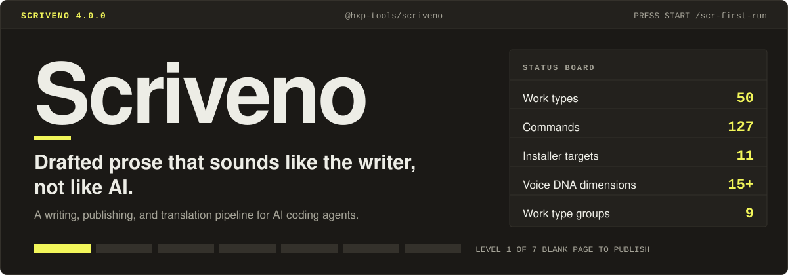
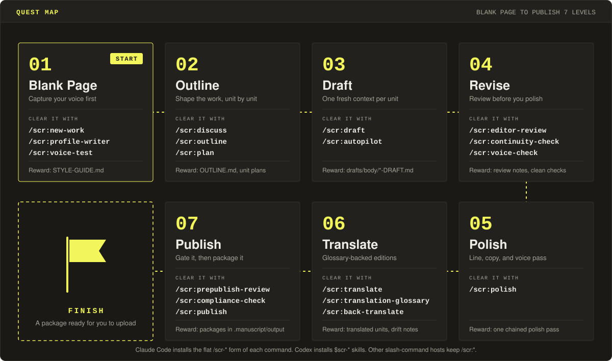
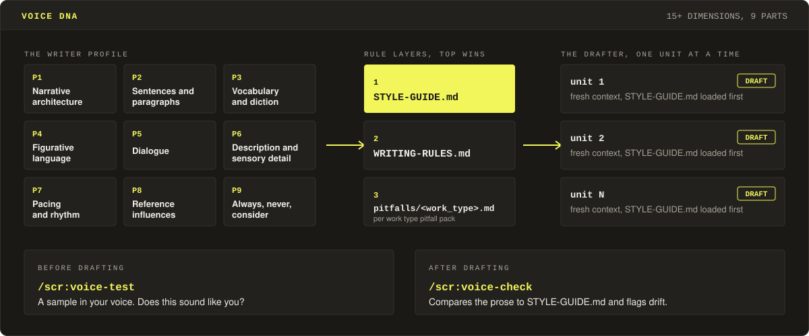
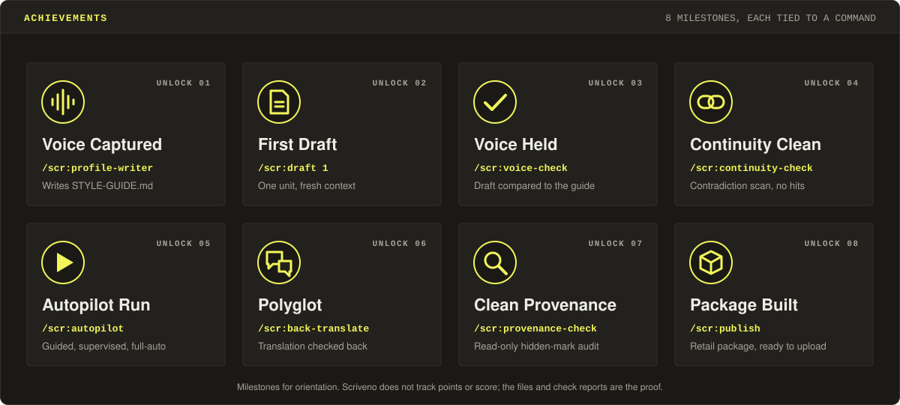
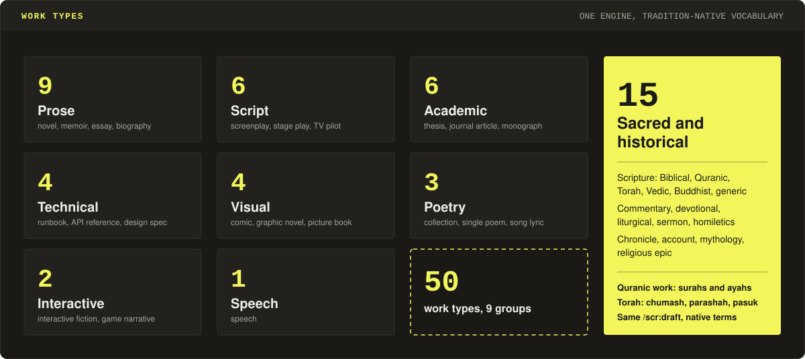

<p align="center">
  
</p>

<p align="center">
  <a href="https://github.com/hannsxpeter/scriveno/actions/workflows/ci.yml"></a>
  <a href="https://www.npmjs.com/package/@hxp-tools/scriveno"></a>
  <a href="CHANGELOG.md"></a>
  <a href="LICENSE"></a>
  <a href="docs/runtime-support.md"></a>
  <a href="https://www.npmjs.com/package/@hxp-tools/scriveno"></a>
</p>

<h3 align="center">Spec-driven writing, publishing, and translation for AI coding agents.</h3>

<p align="center"><em>I don't outline -- Claude does. I don't edit -- Claude does. I don't format -- Claude does. I just write.</em></p>

Scriveno turns your AI coding agent into a voice-preserving writing studio. It runs inside Claude Code, Codex, Cursor, Gemini CLI, and more, and also ships a guided Perplexity Desktop setup path for file-aware support without overstating parity.

Scriveno is best understood as **AI-native longform writing software built around voice preservation**. Its core promise is narrow and high-stakes: drafted prose should sound like the writer, not like AI. The first path is intentionally small: first-run, demo, next, draft, review, save. The range comes after trust is earned: the same engine adapts to technical, sacred, visual, translation, and publishing workflows without forcing them into a novel-shaped template.

Want evidence before features? Start with the [Quick Proof](docs/quick-proof.md), then inspect the [Proof Artifacts](docs/proof-artifacts.md), [Proof Badges](docs/proof-badges.md), and [Versatility Paths](docs/versatility-paths.md).

<details>
<summary>Proof and runtime badges</summary>

[](docs/runtime-support.md#shared-auto-invoke-engine)
[](docs/auto-invoke-policy.md)
[](docs/runtime-support.md#runtime-smoke-and-agent-checks)
[](docs/auto-invoke-policy.md#safe-apply-and-audit-commands)
[](docs/quick-proof.md)
[](docs/quick-proof.md)
[](docs/starter-sets.md)

</details>

---

## Press start

```bash
npx @hxp-tools/scriveno@latest
```

That installs Scriveno into your agent. Then, inside the agent, run the narrow proof path first. Pick the form your host uses:

| Host | First run | Then |
|---|---|---|
| Claude Code | `/scr-first-run` | `/scr-demo`, `cd scriveno-demo`, `/scr-next`, `/scr-draft 5`, `/scr-editor-review 5`, `/scr-save` |
| Codex | `$scr-first-run` | `$scr-demo`, `cd scriveno-demo`, `$scr-next`, `$scr-draft 5`, `$scr-editor-review 5`, `$scr-save` |
| Other slash-command hosts | `/scr:first-run` | `/scr:demo`, `cd scriveno-demo`, `/scr:next`, `/scr:draft 5`, `/scr:editor-review 5`, `/scr:save` |

When you are ready for your own manuscript, run `/scr-new-work` (or `/scr:new-work`, `$scr-new-work`). If you only ever type `/scr-next` in Claude Code, you can complete an entire novel. It always knows what's next.

Optional zero-install terminal checks:

```bash
npx @hxp-tools/scriveno@latest status --project .
npx @hxp-tools/scriveno@latest sync --check
```

The bare `scriveno ...` CLI exists after a global install (`npm i -g @hxp-tools/scriveno`) or while developing from a local checkout. If you only ran `npx @hxp-tools/scriveno@latest`, keep using `npx @hxp-tools/scriveno@latest <command>` for terminal checks.

Shortest proof-first route: [Quick Proof](docs/quick-proof.md). A small command path for your goal: [Starter Sets](docs/starter-sets.md). Range without overwhelm: [Versatility Paths](docs/versatility-paths.md).

---

## The quest map

A manuscript moves through seven levels, from a blank page to a package you can upload. You can skip around, and `/scr-next` always points at the level you are on.

<p align="center">
  
</p>

| Level | Clear it with | Reward |
|---|---|---|
| 1. Blank Page | `/scr:new-work`, `/scr:profile-writer`, `/scr:voice-test` | `STYLE-GUIDE.md` |
| 2. Outline | `/scr:discuss`, `/scr:outline`, `/scr:plan` | `OUTLINE.md` and unit plans |
| 3. Draft | `/scr:draft`, `/scr:autopilot` | `.manuscript/drafts/body/*-DRAFT.md` |
| 4. Revise | `/scr:editor-review`, `/scr:continuity-check`, `/scr:voice-check` | Review notes and clean checks |
| 5. Polish | `/scr:polish` (chains line edit, copy edit, voice check) | One chained polish pass |
| 6. Translate | `/scr:translate`, `/scr:translation-glossary`, `/scr:back-translate` | Translated units and drift notes |
| 7. Publish | `/scr:prepublish-review`, `/scr:compliance-check`, `/scr:publish` | Packages in `.manuscript/output/` |

Scriveno prepares the package. You upload it to the retailer yourself.

---

## Voice DNA: the boss fight

Scriveno's core insight: drafted prose should sound like *you*, not like an AI. Before drafting begins, `/scr:profile-writer` builds a detailed voice profile across 15+ dimensions, saved as `STYLE-GUIDE.md`. Every drafter invocation loads it first, and each atomic unit (a scene, a subsection, a passage) is drafted in a fresh context. The drift controls are fresh context per unit, `STYLE-GUIDE.md` loaded first, and `/scr:voice-check` after drafting. Whether voice held is something to measure, not assume: see the replay-tested guided versus unguided comparison in [Proof Badges](docs/proof-badges.md).

<p align="center">
  
</p>

- Narrative perspective, tense, narrator stance
- Sentence architecture, paragraph rhythm
- Vocabulary register, figurative density, recurring image systems
- Dialogue style, character voice differentiation
- Pacing, transitions, emotional range
- Do/don't/consider rules specific to the writer

See the [Voice DNA Guide](docs/voice-dna.md), and compare a guided and an unguided sample on the same brief in [data/proof/voice-dna](data/proof/voice-dna/README.md).

<details>
<summary>Rule layers, RECORD.md, and sacred registers</summary>

The drafter is also backed by two additional rule layers that scaffold weaker models without overriding the writer's voice: a universal `WRITING-RULES.md` (human-first restraint, factual integrity, AI-tell don'ts, register awareness, detector-aware authenticity, and artifact cleanup loaded into every drafter, voice-checker, and originality-check pass) and per-work-type pitfall packs at `templates/pitfalls/<work_type>.md` (filter words for prose, unfilmable description for screenplays, missing-precondition checks for runbooks, anachronism for sacred commentary, and so on). Conflict resolution is top-down: STYLE-GUIDE.md > WRITING-RULES.md > pitfall pack. See [docs/drafter-quality.md](docs/drafter-quality.md) for the full system, including `draft.rigor` and `draft.context_profile` settings for matching the drafter to the model tier you're routing to, and [Authenticity And AI Detectors](docs/authenticity-and-detectors.md) for the external-detector policy.

Every project also gets `RECORD.md`, a neutral established-content store. `STATE.md` tracks workflow position, `OUTLINE.md` tracks structure, and `RECORD.md` tracks what the work has established: open threads, reader promises, payoffs, continuity facts, and movement that future units must honor.

For sacred and historical texts, Voice DNA is supplemented by 10 sacred voice registers (prophetic, wisdom, legal, liturgical, narrative-historical, apocalyptic, epistolary, psalmic, parabolic, didactic).

</details>

---

## Achievements

Eight milestones worth chasing, each tied to a real command and a file or report you can open.

<p align="center">
  
</p>

The game layer is a map, not a scoreboard. Scriveno does not keep points or XP. `/scr:progress` computes live per-unit progress (done, in progress, untouched) and points to the saved ledger in `.manuscript/PROGRESS.md`, which `/scr:save` refreshes, and the check commands write reports you can read.

---

## Fifty work types, one engine

Scriveno supports 50 work types in 9 groups, each with its own structural hierarchy and word-count guidance. A novel uses `/scr:draft` for chapters. A screenplay uses `/scr:draft` for acts. A Quran commentary uses `/scr:draft` for surahs. Same command, tradition-native vocabulary.

<p align="center">
  
</p>

<details>
<summary>Every work type</summary>

**Prose:** novel, novella, short story, flash fiction, memoir, creative nonfiction, biography, essay, essay collection

**Script:** screenplay, stage play, TV pilot, TV series bible, audio drama, libretto/musical

**Academic:** research paper, thesis/dissertation, journal article, white paper, literature review, monograph

**Technical writing:** technical guide/user guide, runbook/SOP, API or CLI reference, design spec/architecture doc

**Visual:** comic, graphic novel, children's book, picture book

**Poetry:** poetry collection, single poem, song/lyric

**Interactive:** interactive fiction, game narrative

**Speech:** speech

**Sacred & historical:** scripture (Biblical, Quranic, Torah, Vedic, Buddhist, generic), commentary/exegesis, devotional, liturgical text, historical chronicle, historical account, mythological collection, religious epic, sermon, homiletic collection

Each work type has its own structural hierarchy and **industry-standard word count and page range guidance** -- a novel targets 70,000-100,000 words across 20-35 chapters, a screenplay targets 90-120 pages across 3-5 acts. These ranges guide outlining, progress tracking, and drafter pacing. The runnable command ids stay stable, while Scriveno adapts the wording around them -- a Torah commentary still runs `/scr:plan 3`, but frames that work as planning Parashah 3. See the [Work Types Guide](docs/work-types.md).

</details>

---

## What is in the box

Scriveno profiles the writer, loads that voice into every drafting step, and keeps each unit on fresh context so the prose stays specific to the project. From there, it expands into 127 writing commands covering the rest of the pipeline:

- **Create** -- Set up a project with tailored context files. Progressive onboarding, never overwhelming.
- **Write** -- Discuss, plan, draft, and revise one unit at a time. The drafter agent loads your Voice DNA and writes in *your* voice, not generic AI prose.
- **World and research** -- Build characters, peoples, places, geography, relationship maps, and neutral research notes that stay advisory until the writer accepts them.
- **Polish** -- Editor review, line edit, copy edit, continuity check, voice check, beta reader simulation, sensitivity review.
- **Publish** -- Prepublish review, provenance hygiene (audits and cleaning), front/back matter, cover art, blurbs, query letters, KDP packages, IngramSpark packages, EPUB, PDF, Fountain, Final Draft, LaTeX.
- **Translate** -- Deep translation with glossary management, cultural adaptation, back-translation verification, multi-language simultaneous publishing.
- **Collaborate** -- Parallel revision tracks, co-writing workflows, continuity merge checking.

All 127 commands are listed with usage, flags, and examples in the [Command Reference](docs/command-reference.md).

---

## Autopilot mode

Run the full pipeline autonomously. Three profiles:

- **Guided** -- Pause after each unit for review
- **Supervised** -- Batch through several units, pause for review
- **Full-auto** -- Run until complete; only pause on critical failures

```bash
# Claude Code
/scr-autopilot --profile supervised

# Other slash-command runtimes
/scr:autopilot --profile supervised
```

Plus:
- `/scr:autopilot --matter balanced` -- Completes the draft and prepares missing front/back matter through the dedicated matter commands
- `/scr:autopilot-publish` -- Runs quality checks and export packaging unattended. Existing front/back matter is included, while new front/back matter stays in `/scr:front-matter` and `/scr:back-matter`.
- `/scr:autopilot-translate french german spanish` -- Simultaneous multi-language editions

---

## Proactive status

Scriveno ships a shared read-only status engine for every installer target. The public CLI is:

```bash
npx @hxp-tools/scriveno@latest status --project .
npx @hxp-tools/scriveno@latest status . --json
npx @hxp-tools/scriveno@latest status --project . --apply-safe
npx @hxp-tools/scriveno@latest sync --check
npx @hxp-tools/scriveno@latest smoke --json
npx @hxp-tools/scriveno@latest agents --json
npx @hxp-tools/scriveno@latest routes --json
```

After `npm i -g @hxp-tools/scriveno`, you may use the shorter `scriveno status --project .` form.

It inspects disk evidence such as `.manuscript/`, `STATE.md`, `CONTEXT.md`, plan files, drafts, review coverage, notes, revision proposals, translation work, publishing prerequisites, exports, and history, then recommends the safest next command. The engine does not mutate files and does not spawn agents by itself. Command surfaces such as `/scr-next`, `/scr:next`, `/scr:progress`, `/scr:session-report`, and `/scr:sync` call it when local command execution is available, then fall back to embedded markdown logic when a host cannot run Node. See [Auto-Invoke Policy](docs/auto-invoke-policy.md), [Runtime Support](docs/runtime-support.md#shared-auto-invoke-engine), and [Model Adaptation](docs/model-adaptation.md).

<details>
<summary>Candidate agents, local helpers, and manual gates</summary>

The status report separates `Candidate agents`, `Candidate local helpers`, and `Manual gates`. That means Scriveno can say when a route is ready for a drafter, voice-checker, translator, continuity-checker, or review worker, when a deterministic helper such as save or scan is enough, and when writer approval is required for publishing, export overwrites, track merges, or undo.

`--apply-safe` runs only read-only checks and reports write-gated helpers instead of touching manuscript files. `sync --check`, `smoke`, `agents`, and `routes` expose the same cross-runtime audit layer for Claude Code, Codex, Cursor, Gemini CLI, OpenCode, GitHub Copilot, Windsurf, Antigravity, Manus, Perplexity Desktop, and Kimi-compatible generic skill fallback. `smoke` also verifies the shared model adaptation docs copied into `.scriveno/docs/`.

</details>

---

## Installer targets

Scriveno currently ships installer targets for these AI tooling environments:

- **Claude Code** (primary reference runtime)
- **Cursor**
- **Gemini CLI**
- **Codex**
- **OpenCode**
- **GitHub Copilot**
- **Windsurf**
- **Antigravity**
- **Manus Desktop**
- **Perplexity Desktop** (guided local-MCP setup)
- **Generic (SKILL.md)** fallback

**Installer baseline:** `Node.js >=20.0.0` for `npx @hxp-tools/scriveno@latest`, `bin/install.js`, `npx @hxp-tools/scriveno@latest status --project .`, and the proactive audit commands. For new installs, use a currently supported LTS such as Node.js 24; Node.js 20 is a compatibility floor, not the recommended fresh-install target.

**Support note:** Claude Code is the primary reference runtime and installs a flat `/scr-*` command surface. The environments listed above are installer targets, not a claim that every host runtime has verified parity today. Codex currently installs a skill-native `$scr-*` surface with `.toml` agent metadata, Perplexity Desktop is a guided local-MCP target rather than a writable command runtime, and Kimi-compatible or other unlisted hosts should use the generic `SKILL.md` fallback until Scriveno ships a dedicated adapter. See the [Runtime Support](docs/runtime-support.md) compatibility matrix and the [Model Adaptation](docs/model-adaptation.md) guide for install type, support level, verification status, and model-owned spawning boundaries.

---

## Writer mode and developer mode

Scriveno detects non-technical writers and hides git terminology. Instead of `commit`, `branch`, `merge`, `diff` -- you see `save`, `version`, `compare`, `accept changes`. All the power, none of the coding jargon. Technical writers can enable developer mode in settings for full git access and verbose output.

<details>
<summary>The five principles</summary>

1. **The writer's voice is sacred.** The drafter never imposes generic AI style. Every drafted sentence passes through the Voice DNA gate.

2. **Fresh context per atomic unit.** Each scene, subsection, or passage is drafted in a clean context. This prevents voice drift and context bloat, and keeps each unit at its best.

3. **Progressive disclosure.** Onboarding asks 3 questions, not 30. Depth is optional and always additive.

4. **Tradition-native vocabulary.** A Quran commentary uses surahs and ayahs. A Bible study uses books and verses. A screenplay uses acts and scenes. The tool adapts to the tradition -- the writer never adapts to the tool.

5. **`/scr-next` always works in Claude Code.** The universal interface. A writer who only ever types `/scr-next` can complete an entire novel, from blank page to KDP package.

</details>

---

## Documentation

Start here:

- [Quick Proof](docs/quick-proof.md) -- 10-minute proof-first route through install checks, the demo, next, draft, review, and save
- [Getting Started](docs/getting-started.md) -- Install to first draft in 10 minutes
- [Starter Sets](docs/starter-sets.md) -- Small command paths for drafting, world and research, polishing, publishing, translation, sacred commentary, and repair
- [Proof Artifacts](docs/proof-artifacts.md) -- Canonical proof hub for the watchmaker sample flow and Voice DNA before/after bundle
- [Command Reference](docs/command-reference.md) -- All 127 commands with usage, flags, and examples

<details>
<summary>All documentation</summary>

- [Proof Badges](docs/proof-badges.md) -- Evidence levels for major product claims
- [Versatility Paths](docs/versatility-paths.md) -- Curated showcase paths for technical, sacred, visual, translation, and publishing workflows
- [Work Types Guide](docs/work-types.md) -- How 50 work types adapt Scriveno's vocabulary
- [Voice DNA Guide](docs/voice-dna.md) -- The 15+ dimension voice profiling system
- [Authenticity And AI Detectors](docs/authenticity-and-detectors.md) -- How Scriveno handles outside detector scores, process evidence, and authenticity diagnostics
- [Provenance Hygiene](docs/provenance-hygiene.md) -- Read-only watermark and metadata audits with dry-run cleanup and safe cleaned copies
- [Creative Context](docs/creative-context.md) -- Writer-native context routing, craft notes, and core-loop memory
- [Publishing Guide](docs/publishing.md) -- 14 export formats, KDP, IngramSpark, submission packages
- [Sacred Text Guide](docs/sacred-texts.md) -- 15 sacred work types, voice registers, tradition-native features
- [Translation Guide](docs/translation.md) -- Multi-language pipeline with glossary and cultural adaptation
- [Contributing](docs/contributing.md) -- How to add commands, agents, work types, and templates, plus the contributor workflow
- [Architecture](docs/architecture.md) -- How Scriveno works under the hood
- [Configuration](docs/configuration.md) -- Package, installer, constraints, and `.manuscript/config.json` surfaces
- [Auto-Invoke Policy](docs/auto-invoke-policy.md) -- Shared status engine, route intelligence lanes, visible automation status, and agent-spawn boundaries
- [Model Adaptation](docs/model-adaptation.md) -- How Codex, Claude Code, generic/Kimi-compatible hosts, and weaker model tiers consume the same prompts and protocols
- [Route Graph Audit](docs/route-graph.md) -- Generated route graph, automation lanes, and priority fixtures
- [Testing](docs/testing.md) -- What the test suite covers and which checks to run before shipping
- [Release Checklist](docs/release-checklist.md) -- Local, npm, GitHub, and fresh-install release verification
- [Release Notes](docs/release-notes.md) -- Public summary of what changed between package releases
- [Shipped Assets](docs/shipped-assets.md) -- Canonical inventory of bundled export templates and launch-critical files
- [Runtime Support](docs/runtime-support.md) -- Canonical runtime matrix, Node baseline, and verification-status framing

</details>

---

## Status

**Version:** 4.0.0

Scriveno's core command surface is stable across 127 commands, 50 work types, and 11 installer targets. Version 4.0.0 is the relaunch under the scoped package name `@hxp-tools/scriveno`, so the current install command is `npx @hxp-tools/scriveno@latest` and the `scriveno` command it installs is unchanged. There are no command, work-type, or Voice DNA changes in this release. The earlier unscoped `scriveno` package was unpublished, and the older `scriveno-cli` and `scriven-cli` names are historical only. Do not treat any legacy package name as active.

Version 3.8.0 made provenance hygiene executable from the installed package (`scriveno provenance-check` and `scriveno provenance-clean`), with dry-run-first cleaning and an opt-in watermarks-remover provider with local fallback. See [CHANGELOG](CHANGELOG.md) for the full package history and [docs/release-notes.md](docs/release-notes.md) for the public-facing summary. See [Quick Proof](docs/quick-proof.md) for the fastest proof path, [Shipped Assets](docs/shipped-assets.md) for the canonical asset inventory, and [Runtime Support](docs/runtime-support.md) for the runtime compatibility matrix.

---

## License

MIT. See [LICENSE](./LICENSE).

## Contributing

Scriveno is an open project. Contributions welcome -- especially new work types, additional runtime adapters, and voice register definitions for languages and traditions we haven't covered yet. Start with [Contributing](docs/contributing.md).
